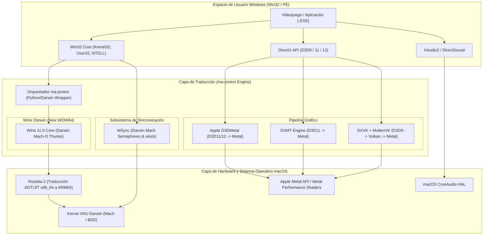

# Arquitectura Interna de ma-proton: Traductor de Compatibilidad Windows para macOS

## 1. Introducción y Propósito

`ma-proton` es una reimplementación y adaptación de la arquitectura de **Valve Proton** específicamente diseñada para el kernel **Darwin (XNU)** y la API gráfica **Apple Metal**.

Mientras que Proton de Valve está optimizado para binarios ELF en distribuciones Linux con controladores Vulkan directos y llamadas al sistema `futex`, `ma-proton` resuelve las limitaciones fundamentales de la plataforma macOS:
* Ausencia de soporte nativo para Vulkan en macOS.
* Arquitectura de hardware basada en Apple Silicon (ARM64).
* Kernel XNU sin interfaz de sincronización `futex`.
* Sistema de páginas virtuales de 16 KB en chips Apple M-Series frente a los 4 KB de Windows x86_64.
* Eliminación absoluta del soporte nativo para binarios de 32 bits desde macOS 10.15.

---

## 2. Diagrama de Arquitectura Global



---

## 3. Desglose de Subsistemas

### 3.1. Pipeline Gráfico: De DirectX a Metal

En Linux, Proton compila HLSL a SPIR-V y envía los comandos a Vulkan con coste de traducción casi nulo. En macOS, no existe controlador de Vulkan en el kernel; todo debe terminar en llamadas a **Apple Metal**.

`ma-proton` gestiona tres rutas intercambiables:

1. **Ruta Apple D3DMetal (GPTK):**
   * **Direct3D 11 y 12 nativos a Metal:** Compilación de bytecodes DXBC/DXIL directamente a Metal Shading Language (MSL) utilizando `libmetalirconverter.dylib`.
   * Mapea buffers de comandos de DirectX a `MTLCommandBuffer` y codificadores `MTLComputeCommandEncoder`.
   * Rendimiento máximo en DirectX 12 y juegos modernos (ej. *Cyberpunk 2077*, *Elden Ring*).

2. **Ruta DXMT (DirectX to Metal Open Source):**
   * Implementación abierta que intercepta la API Direct3D 11 y expone directamente primitivas Metal (`winemetal.dll`).
   * Elimina la necesidad de drivers propietarios y permite optimizaciones específicas para APIs abiertas.

3. **Ruta DXVK + MoltenVK:**
   * Utilizada como fallback para DirectX 9 y DirectX 10.
   * `D3D9 -> DXVK (Vulkan) -> MoltenVK -> Metal`.

### 3.2. Sincronización de Hilos: Darwin MSync vs Linux Fsync

El cuello de botella clásico de Wine reside en la llamada a `wineserver` a través de sockets Unix para cada primitiva de sincronización (`WaitForSingleObject`, `WaitForMultipleObjects`, Mutexes y Eventos).

* **En Linux (Proton):** Valve resolvió esto con **Fsync**, mapeando primitivas NT a llamadas `futex` directas en el kernel de Linux.
* **En macOS (ma-proton):** Darwin no implementa `futex`. `ma-proton` activa **MSync**:
  * Utiliza semáforos de Mach (`mach_semaphore_wait`, `mach_semaphore_signal`).
  * Utiliza primitivas privadas de Darwin `ulock` (`__ulock_wait`, `__ulock_wake`).
  * Reduce la latencia de conmutación de contexto entre hilos a menos de 1 microsegundo, evitando las llamadas a `wineserver` en el 98% de las operaciones de sincronización.

### 3.3. Emulación de CPU y Tamaño de Páginas de Memoria (Apple Silicon)

Los procesadores Apple Silicon (M1 a M4) ejecutan el kernel de macOS con un tamaño de página de memoria virtual de **16 KB** (`PAGE_SIZE = 16384`), mientras que la arquitectura x86_64 y el kernel de Windows asumen páginas de **4 KB** (`PAGE_SIZE = 4096`).

* **Rosetta 2 Emulation Layer:**
  Cuando `ma-proton` ejecuta el runtime x86_64 a través de Rosetta 2, el subsistema `oahd` emula un espacio de direccionamiento de 4 KB para el proceso hijo, permitiendo que las llamadas a `VirtualAlloc` de Windows con granularidad de 4 KB funcionen sin provocar fallos de segmentación (`EXC_BAD_ACCESS`).

### 3.4. Arquitectura New WOW64 (Soporte de 32 bits sin librerías de 32 bits)

Desde macOS Catalina (10.15), Apple eliminó todas las bibliotecas del sistema de 32 bits.
`ma-proton` se apoya en la arquitectura **New WOW64** del core de Wine:
* El proceso anfitrión es siempre un proceso Mach-O de 64 bits.
* Los binarios de Windows de 32 bits se cargan en la mitad inferior del espacio virtual de 64 bits.
* Las llamadas a las DLLs del sistema operativo se convierten ("thunked") directamente en la frontera PE sin cruzar al espacio de usuario Unix de 32 bits.

---

## 4. Estructura del Prefijo de Compatibilidad

El prefijo emulado (`~/.ma-proton/prefixes/default` o el asignado dinámicamente por Steam) mantiene la estructura canónica de Windows:

```
~/.ma-proton/prefixes/<nombre>/
├── drive_c/
│   ├── Program Files/
│   ├── Program Files (x86)/
│   ├── users/
│   └── windows/
│       ├── system32/           # Bibliotecas de 64 bits + DLLs Metal inyectadas
│       │   ├── d3d11.dll       -> Enlazado a backend D3DMetal/DXMT
│       │   ├── d3d12.dll       -> Enlazado a backend D3DMetal
│       │   └── dxgi.dll        -> Enlazado a gestor Metal Surface
│       └── syswow64/           # Bibliotecas de 32 bits WOW64
├── system.reg                  # Registro de sistema Windows
├── user.reg                    # Registro de usuario (Configuración de pantalla Retina)
└── dosdevices/
    ├── c: -> ../drive_c
    └── z: -> / (Raíz de macOS)
```

---

## 5. Protocolo de Integración con Valve Steam

`ma-proton` implementa el protocolo CLI de Proton (`waitforexitandrun` y detección de variables de entorno de Steamworks):

* Al ejecutar un juego desde Steam con parámetro de lanzamiento:
  ```
  ma-proton run %command%
  ```
  `ma-proton` detecta automáticamente `SteamAppId` y `STEAM_COMPAT_DATA_PATH`, asignando un prefijo aislado e inicializando la interoperabilidad con el cliente Steam nativo de macOS.
